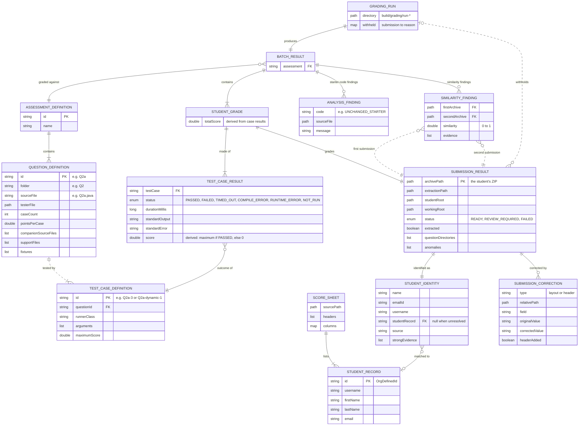

# Entity-relationship diagram

The auto-grader has no database. Its "entities" are the data objects in `src/main/java/autograder/model` (plus `GradingRun` in `grading`), which every stage passes along. This diagram shows what each entity holds and how many of one relate to another.

Generated from the code on `main` at commit `4d25864`. A rendered copy is in [er-diagram.svg](er-diagram.svg).

## How to read it

| Notation | Meaning |
| --- | --- |
| `PK` | Identifier for that entity (unique within a run) |
| `FK` | Field that refers to another entity's identifier |
| Solid line | One object holds the other directly (a field or list) |
| Dashed line | Linked by a matching value, such as a question ID or archive path, not by an object reference |
| `\|\|` | Exactly one |
| `o\|` | Zero or one |
| `\|{` | One or more |
| `o{` | Zero or more |

## Diagram

## Notes on the relationships

- **One submission, one grade.** Every prepared ZIP becomes one `SUBMISSION_RESULT`, and the pipeline creates exactly one `STUDENT_GRADE` for it, even when it is withheld. That grade always has one `TEST_CASE_RESULT` per test case definition (20 instructor cases plus the dynamic cases), using `NOT_RUN` when grading was blocked.
- **A student can be unmatched or matched twice.** `STUDENT_IDENTITY.studentRecord` is empty when ownership could not be resolved. Two ZIPs can also match the same `STUDENT_RECORD`. The pipeline detects that as a duplicate and withholds both rather than guessing.
- **Scores are derived, not stored.** A case's score is its maximum if it passed and zero otherwise. A student's total is the sum of their case scores. Nothing stores a total that could get out of step with the case results.
- **Findings never change marks.** `SIMILARITY_FINDING` (feature 1) and `ANALYSIS_FINDING` (feature 3) are attached to the batch for review only. A similarity finding names its two submissions by archive path.
- **Withheld is a property of the run.** `GRADING_RUN.withheld` maps a submission to the reason its score was not exported. `GradingReportContext` (used by the HTML dashboard) carries the same batch and withheld map, so it is not drawn separately.
- **Type names are simplified.** `path`, `list`, `map` and `enum` stand for Java's `Path`, `List`, `Map` and the `SubmissionStatus`/`TestStatus` enums.
