# UML class overview

A general overview of `src/main/java/autograder`, with one box per package (folder). Every class is shown. Only the main relationships are drawn, so the diagram stays readable: small helper classes appear in their package without arrows.

Generated from the code on `main` at commit `4d25864`. Regenerate it after structural changes.

A rendered copy is in [uml-overview.svg](uml-overview.svg) for slides and offline viewing. To re-render after editing the diagram, save the Mermaid block as `uml.mmd` and run `npx -y @mermaid-js/mermaid-cli@11.4.2 -i uml.mmd -o docs/uml-overview.svg -b white`.

## How to read it

| Arrow | Meaning | Example |
| --- | --- | --- |
| `<\|..` dashed, hollow triangle | Implements an interface | `NGramPlagiarismDetector` implements `PlagiarismDetector` |
| `*--` filled diamond | Owns / is made of | `BatchResult` owns its `StudentGrade`s |
| `o--` hollow diamond | Combines independent parts | `CombinedTestCaseProvider` combines other `TestCaseProvider`s |
| `-->` solid arrow | Uses / holds a reference | `GradingPipeline` uses `CaseExecutor` |
| `..>` dashed arrow | Creates or depends on | `App` creates `GradingPipeline` |

## Diagram

```mermaid
classDiagram
direction LR

namespace autograder {
    class App
    class StarterAnalysis
}

namespace api {
    class PlagiarismDetector {
        <<interface>>
        +compare(submissions, assessment) List~SimilarityFinding~
    }
    class HtmlReportGenerator {
        <<interface>>
        +generate(context, outputDirectory) Path
    }
    class BoilerplateDetector {
        <<interface>>
        +analyze(submission, starterDirectory) List~AnalysisFinding~
    }
    class TestCaseProvider {
        <<interface>>
        +load(assessment) List~TestCaseDefinition~
    }
    class FeedbackGenerator {
        <<interface>>
        +generate(grade, outputDirectory) Path
    }
    class ProgressListener {
        <<interface>>
        +onProgress(stage, item, completed, total)
    }
}

namespace config {
    class AppConfig
    class AppConfigLoader
    class AssessmentConfigLoader
    class ConfigPathPolicy
    class PropertyParsers
    class ExecutionConfig {
        <<record>>
    }
    class PlagiarismConfig {
        <<record>>
    }
    class HtmlReportConfig {
        <<record>>
    }
    class FeedbackConfig {
        <<record>>
    }
    class BoilerplateConfig {
        <<record>>
    }
}

namespace submission {
    class SubmissionProcessor
    class SafeZipExtractor
    class SubmissionValidator
    class IdentityResolver
    class IdentityEvidenceCollector
    class IdentityEvidence
    class RosterIdentityMatcher
    class HeaderCorrectionPlanner
    class HeaderCorrectionApplier
    class WorkingCopyPreparer
    class CorrectionLog
}

namespace roster {
    class ScoreSheetRepository
}

namespace grading {
    class GradingPipeline
    class GradingRun {
        <<record>>
    }
    class GradingDiagnosticsWriter
    class CombinedTestCaseProvider
    class InstructorTestCaseProvider
    class DynamicTestCaseProvider
}

namespace execution {
    class StudentCompiler
    class CaseExecutor
    class ProcessRunner
    class ProcessResult {
        <<record>>
    }
}

namespace plagiarism {
    class NGramPlagiarismDetector
    class JavaTokenizer
    class NGramBuilder
    class SimilarityCalculator
    class Token {
        <<record>>
    }
    class LineRange {
        <<record>>
    }
}

namespace analysis_boilerplate {
    class StarterCodeDetector
    class JavaSourceTokens
}

namespace report {
    class CsvScoreReportWriter
}

namespace report_html {
    class OfflineHtmlReportGenerator
    class HtmlSummaryRenderer
    class HtmlSubmissionTableRenderer
    class HtmlSubmissionDetailsRenderer
    class HtmlCaseRenderer
    class HtmlAnalysisRenderer
    class HtmlSubmissionPresentation
    class HtmlScoreFormatter
    class HtmlEscaper
    class QuestionOutcome
    class QuestionSection {
        <<record>>
    }
}

namespace report_feedback {
    class MarkdownFeedbackGenerator
    class MarkdownDiagnosticFormatter
    class FeedbackFileWriter
}

namespace ui {
    class ConsoleProgressListener
}

namespace csv {
    class CsvCodec
}

namespace util {
    class AnomalyLog
}

namespace model {
    class AssessmentDefinition
    class QuestionDefinition
    class SubmissionResult
    class SubmissionStatus {
        <<enumeration>>
    }
    class StudentIdentity
    class StudentRecord
    class SubmissionCorrection
    class ScoreSheet
    class TestCaseDefinition
    class TestCaseResult
    class TestStatus {
        <<enumeration>>
    }
    class StudentGrade
    class BatchResult
    class GradingReportContext {
        <<record>>
    }
    class AnalysisFinding
    class SimilarityFinding
}

%% interface implementations
PlagiarismDetector <|.. NGramPlagiarismDetector
HtmlReportGenerator <|.. OfflineHtmlReportGenerator
BoilerplateDetector <|.. StarterCodeDetector
FeedbackGenerator <|.. MarkdownFeedbackGenerator
ProgressListener <|.. ConsoleProgressListener
TestCaseProvider <|.. CombinedTestCaseProvider
TestCaseProvider <|.. InstructorTestCaseProvider
TestCaseProvider <|.. DynamicTestCaseProvider

%% entry point wiring
App ..> AppConfig
App ..> SubmissionProcessor
App ..> GradingPipeline
App ..> StarterAnalysis
App ..> HtmlReportGenerator
App ..> FeedbackGenerator
App ..> PlagiarismDetector
App ..> ConsoleProgressListener

%% configuration
AppConfigLoader ..> AppConfig
AppConfigLoader --> AssessmentConfigLoader
AppConfigLoader --> PropertyParsers
AppConfig --> ConfigPathPolicy
AppConfig *-- AssessmentDefinition

%% stage 1: preparing submissions
SubmissionProcessor --> SafeZipExtractor
SubmissionProcessor --> SubmissionValidator
SubmissionProcessor --> IdentityResolver
SubmissionProcessor --> WorkingCopyPreparer
SubmissionProcessor --> ScoreSheetRepository
SubmissionProcessor --> AnomalyLog
SubmissionProcessor --> CorrectionLog
SubmissionProcessor --> ProgressListener
SubmissionProcessor ..> SubmissionResult
IdentityResolver --> IdentityEvidenceCollector
IdentityResolver --> RosterIdentityMatcher
IdentityResolver --> HeaderCorrectionPlanner
IdentityResolver --> HeaderCorrectionApplier
IdentityEvidenceCollector ..> IdentityEvidence
ScoreSheetRepository --> CsvCodec
ScoreSheetRepository ..> ScoreSheet

%% stage 2: compiling and running cases
GradingPipeline --> TestCaseProvider
GradingPipeline --> StudentCompiler
GradingPipeline --> CaseExecutor
GradingPipeline --> PlagiarismDetector
GradingPipeline --> GradingDiagnosticsWriter
GradingPipeline ..> GradingRun
CombinedTestCaseProvider o-- TestCaseProvider
StudentCompiler --> ProcessRunner
CaseExecutor --> ProcessRunner
ProcessRunner ..> ProcessResult

%% stage 3: analysis and reports
NGramPlagiarismDetector --> PlagiarismConfig
NGramPlagiarismDetector --> JavaTokenizer
NGramPlagiarismDetector --> NGramBuilder
NGramPlagiarismDetector --> SimilarityCalculator
JavaTokenizer ..> Token
NGramBuilder ..> LineRange
StarterAnalysis --> BoilerplateDetector
StarterCodeDetector --> JavaSourceTokens
GradingDiagnosticsWriter --> CsvScoreReportWriter
GradingDiagnosticsWriter --> ScoreSheetRepository
CsvScoreReportWriter --> CsvCodec
OfflineHtmlReportGenerator --> HtmlSummaryRenderer
OfflineHtmlReportGenerator --> HtmlSubmissionTableRenderer
OfflineHtmlReportGenerator --> HtmlAnalysisRenderer
HtmlSubmissionTableRenderer --> HtmlSubmissionDetailsRenderer
HtmlSubmissionDetailsRenderer --> HtmlCaseRenderer
HtmlCaseRenderer ..> QuestionSection
MarkdownFeedbackGenerator --> MarkdownDiagnosticFormatter
MarkdownFeedbackGenerator --> FeedbackFileWriter

%% shared data model
AssessmentDefinition *-- QuestionDefinition
ScoreSheet *-- StudentRecord
SubmissionResult *-- StudentIdentity
SubmissionResult *-- SubmissionCorrection
SubmissionResult --> SubmissionStatus
StudentIdentity --> StudentRecord
TestCaseResult --> TestCaseDefinition
TestCaseResult --> TestStatus
StudentGrade --> SubmissionResult
StudentGrade *-- TestCaseResult
BatchResult --> AssessmentDefinition
BatchResult *-- StudentGrade
BatchResult *-- AnalysisFinding
BatchResult *-- SimilarityFinding
GradingRun *-- BatchResult
GradingReportContext --> BatchResult
```

## What each folder does

| Package | Responsibility |
| --- | --- |
| `autograder` | `App` starts the run and connects the stages; `StarterAnalysis` runs the starter-code check after grading |
| `api` | The six interfaces that bonus features plug into |
| `config` | Reads `config.properties` into validated settings objects |
| `submission` | Stage 1: unzip safely, validate folders, identify the student, fix names and headers in a working copy |
| `roster` | Reads the supplied score sheet as the class list |
| `grading` | Stage 2: chooses test cases, coordinates compilation and execution, collects grades |
| `execution` | Runs `javac`/`java` as child processes with deadlines and bounded output |
| `plagiarism` | Feature 1: n-gram similarity between students, excluding starter code |
| `analysis.boilerplate` | Feature 3: detects answers left unchanged from the starter files |
| `report` | Writes the score sheet CSV in the required format |
| `report.html` | Feature 2: the offline HTML dashboard |
| `report.feedback` | Feature 5: per-student Markdown feedback |
| `ui` | Console progress messages |
| `csv` | CSV reading and writing with correct quoting |
| `util` | The anomaly log |
| `model` | Shared data objects passed between stages |

Mermaid namespace names cannot contain dots, so `analysis_boilerplate`, `report_html` and `report_feedback` stand for `analysis.boilerplate`, `report.html` and `report.feedback`.
